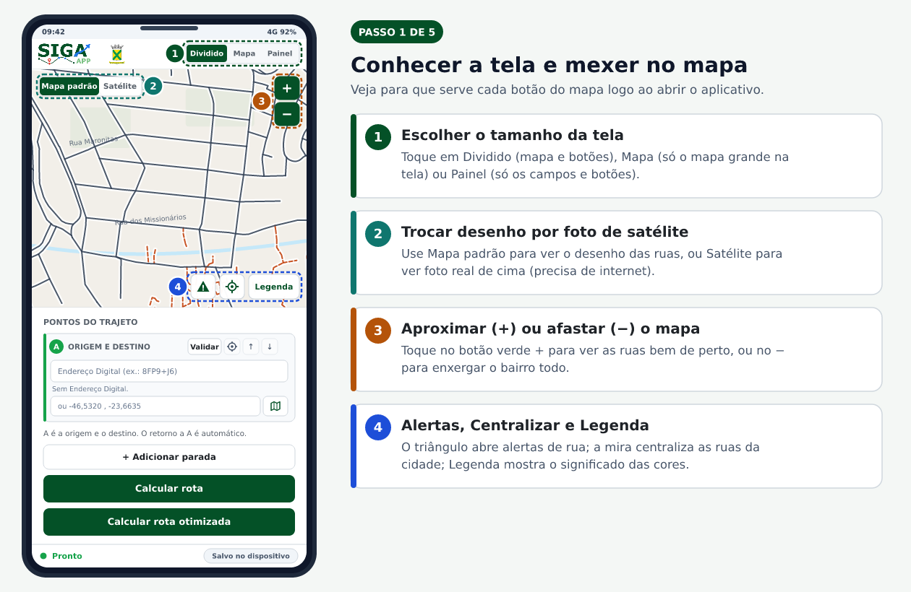
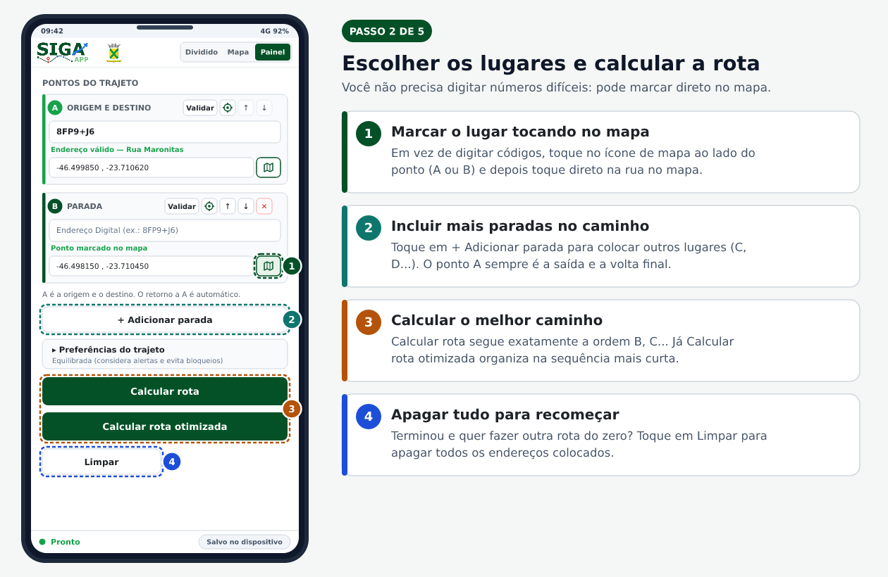
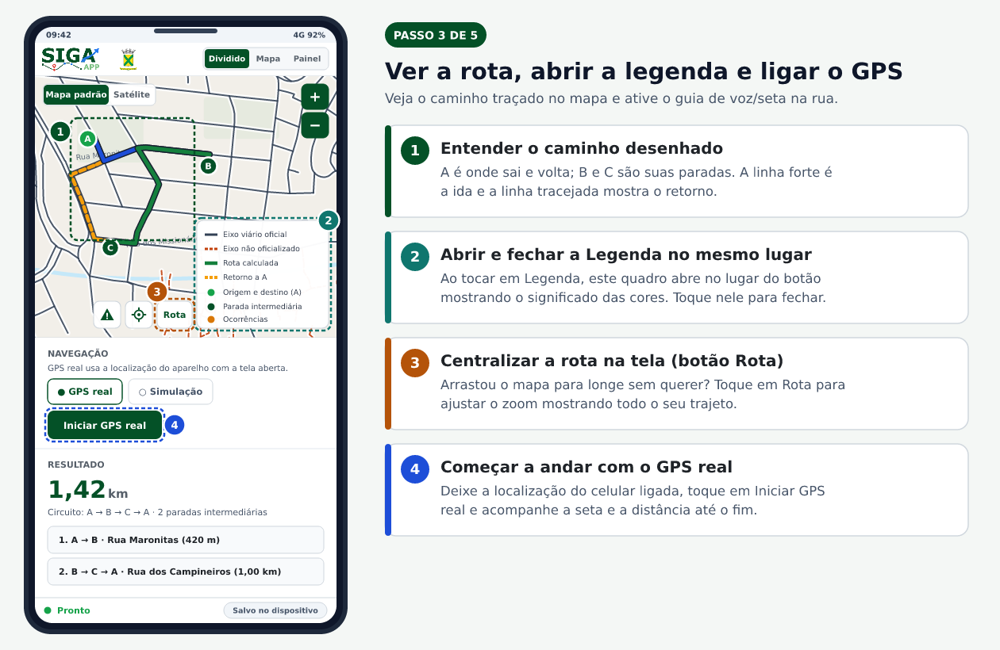
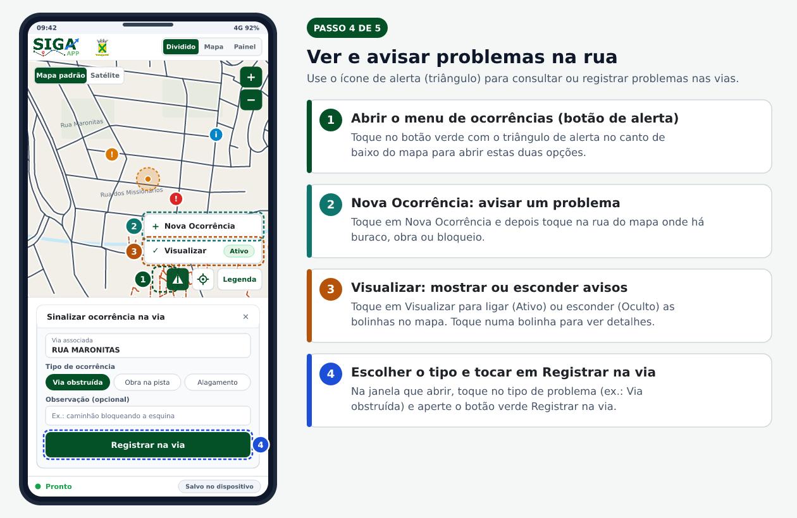
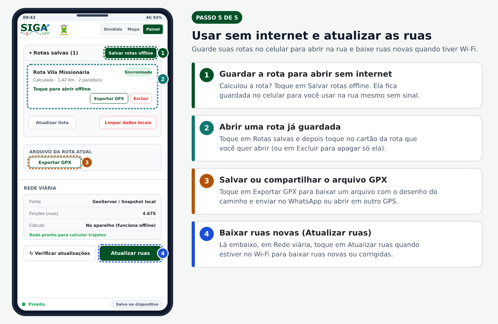

# Manual Rápido — SIGA APP

Um guia bem simples, passo a passo, para usar o aplicativo **SIGA APP** (rotas a pé pelas ruas de Santo André) sem complicação.

> **Serve no celular e no computador:** os desenhos abaixo mostram o aplicativo de celular, mas no computador (site) os botões do mapa têm o mesmo desenho e funcionam igualzinho.

---

## O que faz cada botão do mapa?

| Botão na tela | Nome | Para que serve |
|---|---|---|
| **`+`** e **`−`** (verdes, no alto à direita) | **Zoom** | Chega mais perto (`+`) ou afasta (`−`) o mapa. |
| **Triângulo com `!`** | **Ocorrências (Alertas)** | Abre duas opções: avisar um problema na rua (**Nova Ocorrência**) ou mostrar/esconder avisos no mapa (**Visualizar**). |
| **Mira (`⊕`)** | **Centralizar rede** | Volta o mapa para mostrar todas as ruas da cidade. |
| **`Legenda`** | **Legenda** | Mostra o que cada cor e risco significa. Toque de novo no quadro aberto para fechar. |
| **Ícone de mapa dobrado** | **Marcar no mapa** | Deixa você tocar direto na rua para escolher o lugar, sem precisar digitar código. |

---

## Passo 1 — Conhecer a tela e mexer no mapa

1. **Escolher o tamanho da tela:** no topo, toque em **Dividido** (mapa e botões juntos), **Mapa** (só o mapa grande) ou **Painel** (só a lista).
2. **Trocar o desenho por foto:** toque em **Mapa padrão** (desenho das ruas) ou **Satélite** (foto real de cima, precisa de internet).
3. **Aproximar ou afastar:** toque no **`+`** para chegar perto, ou no **`−`** para ver o bairro todo.
4. **Centralizar e ver cores:** use a **mira** para voltar o mapa para a cidade, **Legenda** para entender as cores e o **triângulo** para ver ou enviar alertas.

---

## Passo 2 — Escolher os lugares e calcular a rota

> **Dica fácil:** o ponto **A** é sempre o lugar de **onde você sai e para onde você volta** no final.

1. **Marcar no mapa (jeito mais fácil):** toque no **ícone de mapa** ao lado do ponto **A** (ou **B**) e depois **toque direto na rua** no mapa.
   *(Se preferir digitar o Endereço Digital, ex.: `8FP9+J6`, escreva no campo e toque em **Validar**.)*
2. **Colocar mais paradas:** toque em **`+ Adicionar parada`** para incluir outros pontos (**B**, **C**…).
3. **Calcular o caminho:**
   - **`Calcular rota`**: faz o caminho na ordem em que você colocou (**A → B → C → A**).
   - **`Calcular rota otimizada`**: o aplicativo escolhe sozinho a ordem mais curta.
4. **Começar de novo:** toque em **`Limpar`** para apagar todos os pontos.

---

## Passo 3 — Ver a rota, abrir a legenda e ligar o GPS

1. **Entender o desenho:** o círculo **A** é a saída e a chegada; **B** e **C** são as paradas. A linha forte mostra a ida e a linha tracejada mostra a volta para **A**.
2. **Abrir e fechar a Legenda:** toque em **`Legenda`** para abrir o quadro no lugar do botão. Para fechar, toque em cima do próprio quadro.
3. **Ver a rota inteira (`Rota`):** se mexer o mapa sem querer, toque em **`Rota`** para centralizar o caminho todo na tela.
4. **Ligar o GPS na rua:** ative a localização do celular e toque em **`Iniciar GPS real`**. O aplicativo continua gravando o seu caminho mesmo se você minimizar ou usar outro aplicativo, até tocar em **Pausar** ou **Encerrar**.

---

## Passo 4 — Ver e avisar problemas na rua

1. **Abrir o menu de ocorrências:** toque no botão com o **triângulo de alerta** no canto inferior direito do mapa.
2. **Avisar um problema (`Nova Ocorrência`):**
   - Toque em **`Nova Ocorrência`**.
   - Toque na rua do mapa onde tem buraco, obra, alagamento ou rua fechada.
   - Escolha o tipo de problema e toque no botão verde **`Registrar na via`**.
3. **Mostrar ou esconder avisos (`Visualizar`):** toque em **`Visualizar`** para ligar (**Ativo**) ou desligar (**Oculto**) os ícones no mapa. Toque em qualquer bolinha no mapa para ler ou confirmar o aviso.

---

## Passo 5 — Usar sem internet e atualizar as ruas

1. **Guardar a rota para usar na rua sem internet:** depois de calcular, toque no botão verde **`Salvar rotas offline`**.
2. **Abrir uma rota guardada:** abra **`Rotas salvas`** e toque na rota desejada. *(Se quiser apagar uma rota guardada, toque em **`Excluir`**.)*
3. **Salvar ou enviar o arquivo da rota (`Exportar GPX`):** cria um arquivo do caminho para guardar no aparelho ou mandar para outra pessoa.
4. **Baixar ruas novas (`Atualizar ruas`):** lá embaixo, em **Rede viária**, toque em **`Atualizar ruas`** de vez em quando (quando estiver no Wi-Fi) para baixar ruas novas ou corrigidas.

---

## Ajuda rápida — "E se acontecer isso?"

- **Não sei digitar código ou coordenada:** não precisa! Toque no **ícone de mapa** ao lado do ponto e toque na rua desejada.
- **O mapa foi parar longe ou sumiu:** toque no botão de **mira** (canto inferior direito) para voltar o mapa para Santo André, ou em **`Rota`** para ver seu caminho.
- **Estou na rua e caiu a internet:** suas rotas salvas com **`Salvar rotas offline`** e o cálculo das ruas já baixadas continuam funcionando no aparelho.
- **Apareceu um erro ou quero recomeçar:** toque em **`Limpar`** para começar outra rota.
